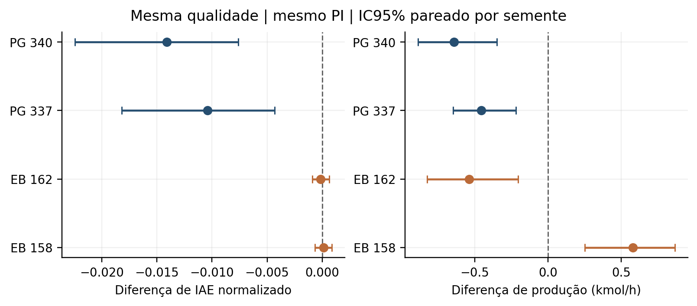
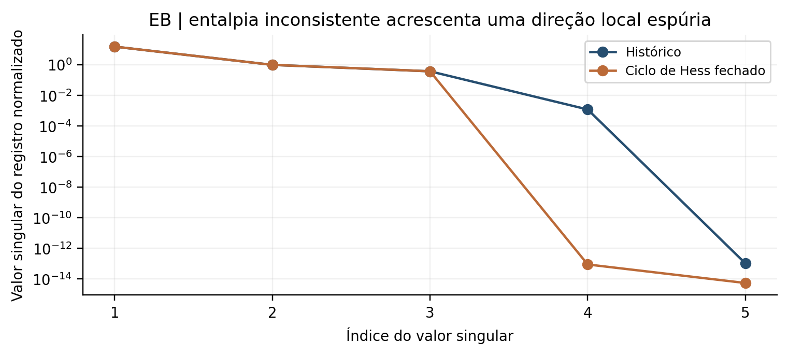

# Escolha do regime operacional e limites de informação no controle inferencial de reatores químicos

Estudo computacional exploratório de propilenoglicol e etilbenzeno

10 de outubro de 2026

## Resumo

Investiga-se se a operação pode facilitar o controle de composição sem medição química contínua, preservando dois modelos históricos de reatores. A campanha combina auditoria física, excitação térmica, ciclos com recursos comparáveis, mapas de sensibilidade e políticas congeladas sob incerteza. No propilenoglicol, excitação senoidal reduziu a incerteza de uma qualidade futura, sem remover dois modos químicos invisíveis. A seleção do regime reduziu o erro médio do mesmo PI térmico em 41,8% com qualidade nominal igual, mas diminuiu a produção em 2,24% e apresentou violações térmicas. No etilbenzeno, a melhora de tracking desapareceu quando a qualidade foi igualada. Nenhum dos ciclos admissíveis superou um estacionário encontrado com recursos iguais ou menores. Uma ablação termodinâmica mostrou que um pequeno defeito de Hess pode aumentar artificialmente o posto de observabilidade local. Os resultados sustentam uma metodologia de falsificação de ganhos inferenciais, sem estabelecer dominância operacional, segurança industrial ou um princípio universal.

Palavras chave: controle inferencial; operação de reatores; observabilidade; invariantes; projeto de experimentos.

## Introdução e revisão crítica

O desempenho de um sistema de controle depende tanto da política quanto do regime físico em que ela atua. Quando a composição não é medida continuamente, mudar a alimentação ou a temperatura pode alterar simultaneamente a produtividade, a informação térmica e a sensibilidade da qualidade. A pergunta relevante é se essa intervenção melhora decisões sob a mesma especificação e restrições.

Operação periódica não é uma ideia nova, inclusive para propilenoglicol [R01]. Resposta não linear em frequência e manipulação com defasagem já foram usadas para avaliar sistemas reacionais [R03, R04]. Resultados recentes em metanol mostram atividade atual nessa linha [R06–R08], mas não autorizam transferir benefícios para outras cinéticas. Controle auto-otimizante relaciona a escolha de variáveis à perda econômica [R13]. Projeto de experimento voltado à decisão explicita que precisão paramétrica e utilidade operacional são objetivos diferentes [R20, R21].

Há antecedentes igualmente importantes para os resultados negativos. Invariantes impõem restrições de observabilidade em CSTRs [R09, R10]; avanços de reação podem simplificar modelos e controladores [R11, R22]. A modelagem por entalpia interfere no projeto de observadores [R12], e propriedades termodinâmicas podem exigir reconciliação [R23]. A contribuição pretendida aqui é testar essas relações nos benchmarks recuperados, expondo comparações confundidas e limites de interpretação. Não se afirma novidade internacional de cada componente.

## Modelos físicos e procedência

O PG parte da dissertação de Brandão de 2019 [R25] e dos códigos históricos e reconstruídos associados. Os seis estados são as concentrações A, B, produto C e inerte M, além das temperaturas do reator e do trocador. A cinética histórica é de primeira ordem em A. Com volume fixo, taxa r e diluição D:

$$
\dot c=D(c_f-c)+\nu r,\qquad
\nu=(-1,-1,1,0)^T,\qquad r=k(T)C_A.
$$

O balanço térmico usa capacidade proporcional à soma das capacidades molares ponderadas pelas concentrações. O calor do trocador depende diretamente da vazão refrigerante e da temperatura do reator; a temperatura dinâmica do trocador não realimenta o balanço do reator. Essa assimetria foi preservada, em vez de substituída por uma camisa convencional. O limite principal é 160 °F, equivalente a 344,261 K; o limite posterior de 180 °F não foi usado para aceitar trajetórias.

O EB é a reconstrução do primeiro reator do TFC de Brandão [R26], associado ao processo discutido por Luyben [R14]. Seus estados são E, B, EB, DEB e temperatura. As reações são E+B para EB, E+EB para DEB e B+DEB para dois EB. As três taxas foram preservadas, assim como o reciclo de entrada nominal. O volume é 200 m³. O produto controlado é a fração molar de EB; a produção líquida desconta o EB que entra no reciclo. O fluxograma com separação e reciclos dinâmicos não foi executado.

A reconstrução EB não é uma planta termodinamicamente reconciliada. Os coeficientes históricos tratados como capacidades caloríficas coincidem aproximadamente com entalpia dividida por temperatura em °C. O dever nominal da reconstrução é 25,370 MW, enquanto o backup Aspen registra 9,088 MW em uma condição próxima, mas distinta. O envelope de 140,85 a 165 °C é exploratório, não industrial certificado. Os novos ensaios assumem acesso a um dever térmico idealizado; essa autoridade adicional é declarada.

## Formulação científica

Considere a incerteza em inventários e parâmetros, representada por uma distribuição b compatível com o histórico de entradas e temperaturas. A escolha de regime z e política causal π deve minimizar custo operacional, incluindo transições, qualidade, produção, recursos e risco. Uma medida relevante de falta de informação é o arrependimento:

$$
\mathcal R(b,z)=\min_\pi {\mathbb E}_b[J(\xi,z,\pi)]
-{\mathbb E}_b[\min_\pi J(\xi,z,\pi)].
$$

A matriz de Fisher fornece um instrumento local, mas não define esse valor. Menor variância de qualidade pode resultar de menor incerteza, menor sensibilidade ou menor influência do inventário inicial. Para uma classe de condições indistinguíveis, uma garantia comum exige interseção não vazia entre suas políticas admissíveis que atendem à especificação. Mudar o regime pode ampliar essa interseção ou eliminá-la por restrições térmicas. A campanha aproxima esse problema por mapas, políticas fixas e decisões finitas; não resolve a otimização global sobre todas as políticas.

No PG, duas perturbações químicas com A e temperaturas iguais e capacidade térmica total igual permanecem termicamente indistinguíveis. Sua diferença segue

$$
\delta c(t)=\delta c(0)\exp\left[-\int_0^t D(s)\,ds\right].
$$

Excitação comum não identifica esses modos. Uma separação inicial de produto de 0,5 kmol/m³ impede garantia simultânea de uma banda de ±2% antes de pelo menos 0,240 h, mesmo usando o maior D permitido. Essa é uma condição necessária; limites de velocidade podem torná-la mais restritiva. O antecedente são os invariantes, e não uma propriedade criada pelo estimador.

## Métodos experimentais

A triagem avaliou 44 projetos de excitação, 144 ciclos e 376 linhas de paisagem estacionária. Os sinais incluem degrau, pulso realizável, PRBS, chirp, senoides e multissenoides. As derivadas incluem inventário inicial e parâmetros térmicos desconhecidos, com escalas físicas mantidas entre regiões. Os ciclos foram avaliados após fechamento periódico, com verificação da partida e médias reais dos atuadores.

O teste não linear de informação compreendeu 192 ajustes MAP, quatro sinais e 24 sementes por reator, das quais oito continham bias fora da família ajustada. A comparação decisória principal usa as 16 sementes da família correta e 17 ações estacionárias futuras comuns, com oráculo de parâmetros claramente identificado. O custo inclui qualidade e penalização térmica; não representa lucro nem controle ótimo dinâmico.

Na malha fechada, os ganhos de um PI térmico com filtro e integral foram selecionados no nominal e congelados. A política não recebe composição verdadeira nem usa a composição estimada em paralelo. A campanha inicial de regiões contém 2304 execuções rotuladas e famílias de mismatch cinético, térmico, combinado, instrumental e fora do domínio. Regiões coincidentes não são réplicas independentes.

Após detectar que a comparação inicial mudava a referência química, executou-se uma rodada exploratória adicional de 216 trajetórias, com três famílias e 12 sementes inéditas. Ajustou-se a alimentação para manter exatamente a mesma qualidade nominal nos pontos comparados. Os recursos resultantes foram reportados, sem presumir igualdade. Intervalos de 95% usam bootstrap pareado de 4000 reamostragens por semente, sem tratar as famílias da mesma semente como independentes. Não houve correção de multiplicidade.

Os baselines adaptados incluem C0, C2 e C3 no PG e reconstrução FKE+PI, cascata e NMPC com envelope no EB, totalizando 180 trajetórias. Ensaios adicionais cobrem esquecimento, amostra atrasada, supervisão, gêmeos e coordenadas reduzidas. Quinze testes científicos e o fluxo E2E foram executados. Dez trajetórias foram reintegradas por DOP853, com diferença térmica máxima de 0,000214 K em relação à integração principal.

## Resultados

### Informação não equivale a decisão

No PG, a melhor senoide reduziu o desvio posterior local da qualidade futura de 0,053965 para 0,008416 kmol/m³. Na validação não linear, o RMSE caiu de 0,016685 para 0,006019. O arrependimento médio passou de 0,105895 a 0,004239; a diferença teve IC95% de −0,183124 a −0,034132. Entretanto, o degrau teve arrependimento médio 0,002931, menor que o da senoide. Logo, a ordenação por precisão preditiva não coincidiu com a ordenação decisória.

No EB, a redução local de desvio posterior foi 7,1%. O arrependimento médio da senoide caiu de 1,496401 para 0,811008, mas o IC da diferença, de −1,695583 a 0,190828, incluiu zero. Não se demonstrou separação confiável das três contribuições cinéticas nem um projeto universalmente superior.

### Periodicidade e seleção de regime

Foram admissíveis 68 ciclos PG e 45 EB. Os maiores ganhos de produção sobre o nominal foram apenas 0,164% e 0,031%. Frente a estacionários encontrados com recursos iguais ou menores, os melhores ciclos ficaram 12,622% e 0,898% abaixo, respectivamente. Esses resultados refutam a dominância da família examinada, não toda forma de operação periódica.

Os mapas identificaram regiões produtivas menos sensíveis em ambos os modelos. No PG, o ponto econômico substituto e o de menor sensibilidade diferiram. No EB, quatro critérios selecionaram o mesmo ponto para os pesos iniciais, mas a seleção mudou sob outros pesos. Menor sensibilidade não foi confundida com maior posto de observabilidade.

Na rodada com qualidade comum, os resultados do PI congelado foram:

| Comparação com nominal | PG a 337 K | PG a 340 K | EB a 162 °C |
|---|---:|---:|---:|
| Variação do IAE normalizado | −30,85% | −41,82% | −0,26% |
| Variação da produção | −1,59% | −2,24% | −0,12% |
| Variação da alimentação | −8,33% | −11,98% | −0,72% |
| Trajetórias com violação | 4/36 | 3/36 | 0/36 |

No PG a 340 K, a diferença de IAE foi −0,014114, IC95% [−0,022466; −0,007626]. A produção caiu 0,638944 kmol/h, IC95% [−0,886668; −0,348401]. O nominal também violou limites em 3/36 trajetórias; a duração média das violações aumentou na alternativa. A condição não é aceita como segura. No EB, o IC da diferença de IAE incluiu zero e o ganho praticamente desapareceu.

{width=95%}

### Informação aparente por inconsistência física

O fechamento isolado do ciclo de Hess trouxe uma falsificação adicional. Seja N a matriz estequiométrica, R a derivada das taxas e D a diluição. O bloco químico linearizado é \(A_c=-DI+NR\). Se \(\Delta H^T=h^TN\), então todo \(v\in\ker(NR)\) satisfaz \(A_cv=-Dv\) e \(\Delta H^TRv=0\). Como os demais termos térmicos da reconstrução não dependem da concentração, esses modos ficam invisíveis à temperatura na linearização.

Nos doze equilíbrios examinados, o núcleo tem dimensão dois. O residual histórico de Hess, 5,5 kcal/kmol, acrescentava uma direção térmica espúria, elevando o posto local de três para quatro. No nominal, o quarto valor singular do registro normalizado passou de 0,001183 para aproximadamente 9e-14 após o fechamento. Seu autovalor de Fisher histórico era apenas 1,4e-6: posto maior não significava informação prática apreciável.

{width=90%}

Outro contrafactual trocou incorretamente a referência de temperatura e reajustou Q no nominal. O equilíbrio pôde ser preservado, mas o ganho térmico de alimentação mudou de 1,515 para 4,138 °C por (m³/h). Uma calibração escalar estacionária, portanto, pode esconder uma derivada física incorreta.

## Discussão e limitações

Os resultados favorecem a seleção de regime como variável de pesquisa, mas refutam uma interpretação universalmente favorável. O PG permite reduzir erro sem trocar controlador; ainda assim, os cenários térmicos invalidam a promoção da alternativa. O EB evidencia o risco de atribuir melhoria à informação quando parte do efeito vem de mudança de referência. Transferiu-se uma filosofia experimental, não parâmetros ou uma política ótima.

Três falsificações mudaram a interpretação. Um piloto periódico parecia ganhar aproximadamente 5,4% de produção PG porque a limitação de velocidade deslocava a média da alimentação; a correção eliminou o ganho. A renovação acumulada igual produziu a mesma ambiguidade terminal dos gêmeos PG, apesar de diferenças transitórias. A ablação de Hess mostrou que até o posto formal pode ser favorecido por uma inconsistência.

O atlas adversarial é finito e não certifica um núcleo de viabilidade. Os oráculos de estado e parâmetros são restritos às políticas avaliadas, não ótimos globais. A amostra química é um protocolo separado, com atraso causal; sua seleção por variância não dominou horários fixos em controle. O supervisor e as combinações não demonstraram ganho adicional seguro.

Toda a evidência nova é computacional. MATLAB, Aspen e planta física não foram executados. A termodinâmica EB, a idealização de remoção de calor, o reciclo fixo, os priors sintéticos, o pequeno número de sementes independentes e a busca finita limitam inferências industriais. A revisão é dirigida e encerrada em 10/10/2026. O efeito local de Hess tem antecedentes em invariantes e observadores por entalpia e requer revisão adicional antes de uma reivindicação de originalidade.

## Conclusões

Modificar a operação pode melhorar inferência ou reduzir a informação necessária para algumas decisões, mas os mecanismos e os custos precisam ser separados. Nos modelos estudados, não foi demonstrada uma região segura que melhorasse simultaneamente qualidade, produção e informação nos dois processos. A contribuição mais madura é um protocolo reprodutível que confronta ganhos aparentes com recursos iguais, qualidade comum, limites informacionais e consistência física. Os resultados negativos e a observabilidade espúria merecem investigação adicional, sem serem apresentados como uma nova tecnologia industrial.

## Procedência e disponibilidade

O código, dados brutos, sementes, modelos, testes e figuras acompanham o pacote da campanha. Os modelos históricos são de Walter Yanko de Aragão Brandão [R25, R26]. A participação documentada de Arioston Araújo de Morais Júnior é de orientação no TFC e banca/agradecimentos na dissertação; a orientação do mestrado é de Heleno Bispo da Silva Júnior. O manuscrito não atribui nova coautoria, contribuição individual ou afiliação. Autoria e destino de submissão exigem revisão dos pesquisadores.

## Referências

As referências completas são inseridas a partir do registro verificado da revisão bibliográfica, mantendo os identificadores R.
