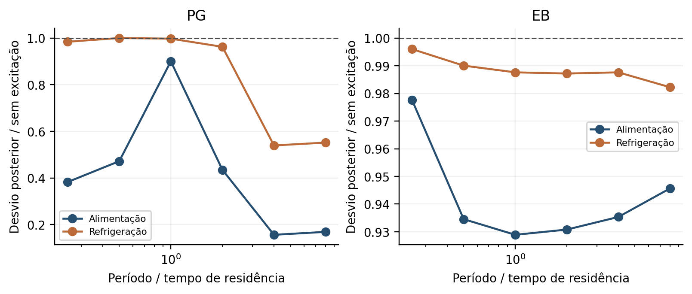
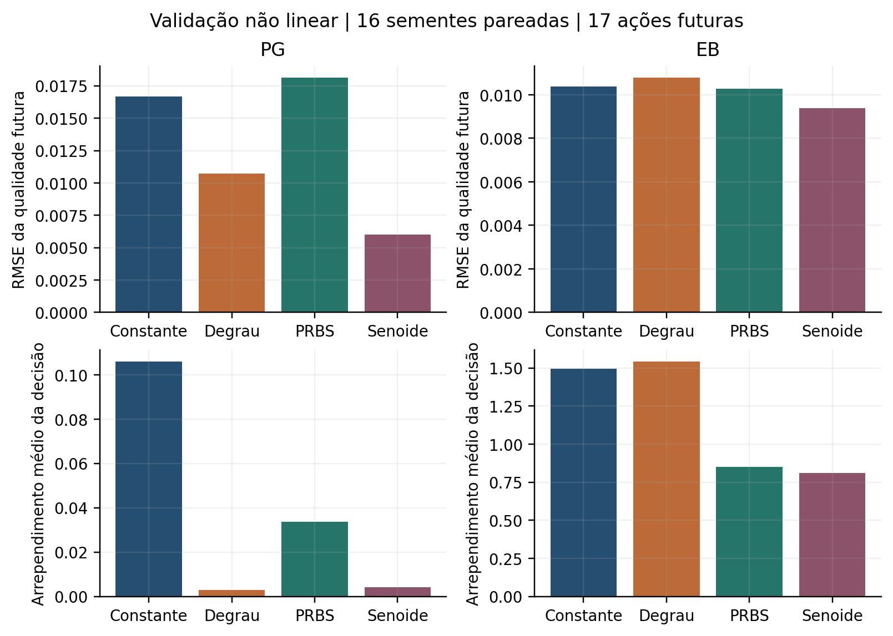
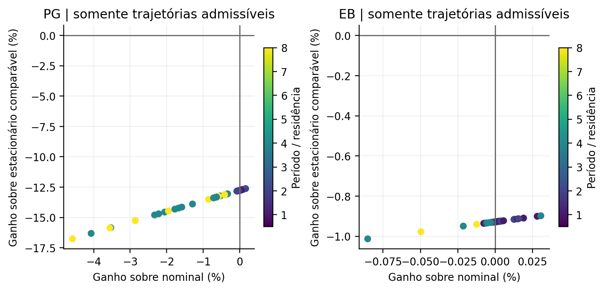
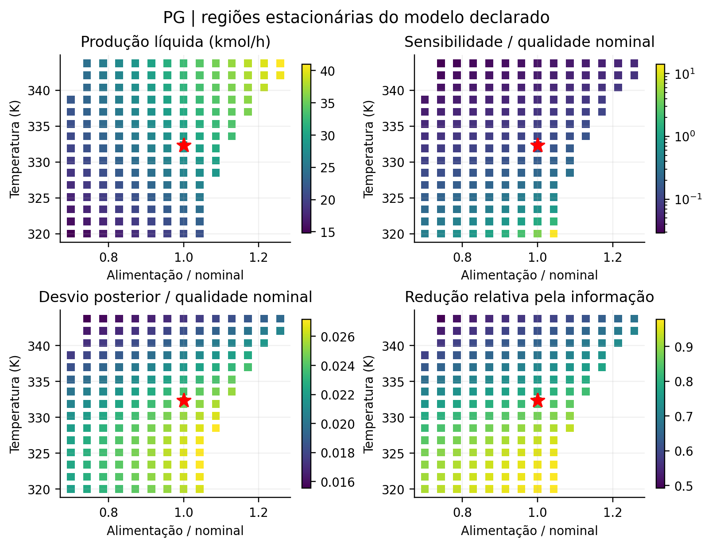
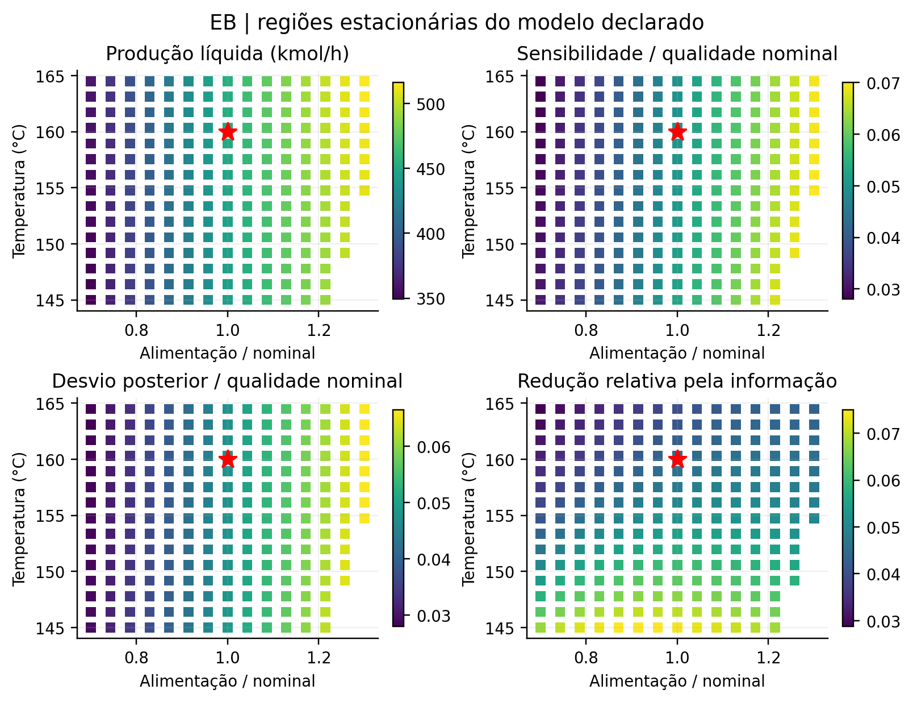

# Resultados e recomendação científica

## Conclusão principal

Modificar a operação alterou a informação e o desempenho do controle nos modelos recuperados, mas não produziu uma solução segura e dominante nos dois reatores. A conclusão mais forte é metodológica: a escolha de regime só pode receber crédito após separar aquisição de informação, redução de sensibilidade, dissipação de inventários, mudança de especificação e consumo de recursos.

O PG apresentou ganhos de inferência e menor erro com o mesmo PI térmico. Parte das condições mais favoráveis ao erro violou o limite histórico de 160 °F sob mismatch. O EB apresentou ganhos locais pequenos de informação, sem melhora clara de tracking quando a referência química foi mantida igual. Sua reconstrução continua termodinamicamente não reconciliada. Nenhuma nova trajetória é recomendada para planta real.

## Excitação e informação química

Foram avaliados 44 projetos térmicos, com amplitude, velocidade e tempo de observação documentados. As matrizes incluem inventário inicial e parâmetros térmicos desconhecidos. O alvo comparável é uma qualidade estacionária futura comum, evitando que a fase final do ciclo favoreça um sinal.

| Modelo | Desvio posterior sem excitação | Melhor senoide de alimentação | Redução local |
|---|---:|---:|---:|
| PG | 0,053965 kmol/m³ | 0,008416 kmol/m³, período de aproximadamente 4 residências | 84,4% |
| EB | 0,013264 em fração molar | 0,012321, período de aproximadamente 1 residência | 7,1% |

Esses números são previsões locais sob o prior adotado. Não são RMSE observado nem prova de identificação individual de todas as constantes. As correlações e desvios posteriores por parâmetro estão nos dados brutos. No PG, dois modos químicos permanecem exatamente invisíveis para qualquer entrada comum. No EB, três taxas de reação e efeitos térmicos continuam fortemente confundidos.

{width=95%}

A validação não linear fez 192 ajustes MAP: 16 sementes com a família correta e oito com bias térmico não modelado, quatro sinais e dois reatores. Somente temperaturas e entradas foram fornecidas ao ajuste. A decisão posterior escolhe entre 17 alvos de refrigeração; um oráculo de parâmetros calcula o arrependimento dessa família finita.

| Modelo e sinal | RMSE da qualidade futura | Arrependimento médio |
|---|---:|---:|
| PG constante | 0,016685 | 0,105895 |
| PG degrau | 0,010745 | 0,002931 |
| PG PRBS | 0,018125 | 0,033725 |
| PG senoide | 0,006019 | 0,004239 |
| EB constante | 0,010388 | 1,496401 |
| EB senoide | 0,009379 | 0,811008 |

No PG, a diferença de arrependimento senoide menos constante foi −0,101655, IC bootstrap pareado de 95% [−0,183124; −0,034132]. A redução média de 96,0% se refere a esse custo estacionário particular, não a IAE dinâmico nem a lucro. O degrau teve arrependimento médio ainda menor; não se demonstrou superioridade da senoide sobre a excitação convencional.

No EB, a redução média de 45,8% teve IC da diferença [−1,695583; 0,190828], incluindo zero. Além disso, alguns testes de degrau/PRBS infringiram o envelope térmico e não podem ser promovidos como projetos seguros. Os oito casos com bias fora da família ajustada permanecem separados no arquivo de contrastes. Não se usa convergência numérica do MAP como certificado de identificabilidade.

{width=93%}

## Periodicidade sob recursos comparáveis

A varredura examinou 144 candidatos senoidais, quadrados suavizados e multissenoidais, com amplitudes, fases e duty cycles variados. Foram aceitos 68 de 72 no PG e 45 de 72 no EB. A partida inteira foi verificada, e os últimos quatro ciclos foram usados depois de atingir fechamento periódico. A referência estacionária é o melhor ponto encontrado numa grade de alimentação e temperatura, com recursos iguais ou menores.

| Resultado máximo na família admissível | PG | EB |
|---|---:|---:|
| Ganho de produção sobre nominal | +0,1637% | +0,0305% |
| Ganho sobre estacionário comparável | −12,6217% | −0,8982% |
| Produção do ciclo correspondente, kmol/h | 28,7460 | 451,3268 |
| Produção do estacionário comparador, kmol/h | 32,8984 | 455,4171 |

O comparador é o melhor encontrado, não um ótimo global certificado. Isso basta para refutar a dominância dos ciclos examinados: existe uma alternativa estacionária melhor. Não basta para provar que toda periodicidade possível é inútil. Nenhuma melhora simultânea robusta de produção, seletividade e informação foi demonstrada.

Um piloto parecia produzir ganho PG de cerca de 5,4%, mas o limitador de velocidade deslocava a alimentação média. Esse resultado foi invalidado, arquivado e repetido após a correção. Calor removido, média e quadrado do atuador e variação total são reportados separadamente. No PG, a seletividade é identicamente um porque o modelo não contém reação secundária; não há base para anunciar melhoria de seletividade química.

{width=95%}

## Paisagem de sensibilidade e operação

O mapa contém 376 linhas. As seleções exigem pelo menos 90% da produção nominal e margem térmica nominal de 2 K. O1 maximiza uma função econômica substituta; O2 reduz sensibilidade; O3 reduz incerteza posterior da qualidade; O4 combina critérios. Os pesos são declarados no código e não representam preços industriais.

| Modelo e região | Temperatura | Alimentação relativa | Produção, kmol/h | Sensibilidade relativa |
|---|---:|---:|---:|---:|
| PG nominal | 332,334 K | 1,0000 | 28,6991 | 0,13111 |
| PG O1 | 342,064 K | 1,1714 | 37,7523 | 0,06046 |
| PG O2 e O3 | 342,064 K | 0,8286 | 26,8989 | 0,03805 |
| PG O4 | 342,064 K | 1,1286 | 36,4043 | 0,05595 |
| EB nominal | 160 °C | 1,0000 | 451,1889 | 0,04981 |
| EB O1 a O4 | 161,714 °C | 0,8714 | 416,5168 | 0,04051 |

No PG, há regiões menos sensíveis, mas próximas do teto histórico. No EB, as quatro seleções coincidem para esses pesos e essa grade. A variação de preços substitutos muda a seleção. Menor desvio posterior pode decorrer de menor sensibilidade da qualidade, mesmo sem maior informação medida; O3 não deve ser interpretado como “máxima observabilidade”.

{width=95%}

{width=95%}

A campanha inicial de malha fechada contém 2304 execuções rotuladas. Para cada região, há cinética, parâmetros térmicos, incerteza combinada, falhas de sensor e casos fora do domínio. Os ganhos foram escolhidos na condição nominal e congelados. As comparações principais usam 12 clusters de sementes; regiões coincidentes não contam como evidência independente.

Com alimentação nominal PG e referência própria de cada região, 340 K reduziu o IAE normalizado em 41,0% e aumentou produção em 10,3%, mas a fração de trajetórias com violação térmica subiu de 8,3% a 15,0%. Isso não é um ganho operacional aceitável. No EB, a região O2 reduziu erro em 13,8%, com 7,8% menos produção e 12,9% menos alimentação. Essa comparação ainda mudava a qualidade desejada.

## Verificação com a mesma referência de composição

Para remover esse fator de confusão, uma rodada exploratória adicional usou 216 trajetórias, três famílias adversas e 12 sementes inéditas. A vazão de alimentação foi resolvida para que a qualidade estacionária nominal fosse exatamente a mesma em todas as regiões. O PI, suas memórias e os limites permaneceram os mesmos.

| Mudança em relação ao nominal | PG a 337 K | PG a 340 K | EB a 162 °C |
|---|---:|---:|---:|
| IAE normalizado | −30,85% | −41,82% | −0,26% |
| Produção média | −1,59% | −2,24% | −0,12% |
| Alimentação média | −8,33% | −11,98% | −0,72% |
| Calor removido | -25,08% | -40,61% | -1,67% |
| Trajetórias com violação | 4/36 | 3/36 | 0/36 |
| Violações no nominal pareado | 3/36 | 3/36 | 0/36 |

No PG a 340 K, o IAE normalizado caiu de 0,033747 para 0,019633. A diferença foi −0,014114, IC95% [−0,022466; −0,007626]. A produção caiu 0,638944 kmol/h, IC95% [−0,886668; −0,348401]. A média de passos com violação aumentou de 1,333 para 2,778, embora a diferença não seja estatisticamente resolvida neste pequeno conjunto. Houve picos acima de 355 K; o limite aceito continua 344,261 K. Portanto, nem o nominal nem a alternativa estão certificados para essa incerteza.

No EB a 162 °C, a diferença de IAE foi −0,000135, IC95% [−0,000890; 0,000626]. O efeito é compatível com zero. A 158 °C também não apareceu melhora clara. Esta rodada enfraquece a hipótese de um princípio operacional compartilhado que melhore tracking sem trocar controlador.

A redução de calor removido não é automaticamente economia de utilidades: depende de nível térmico, bomba e rede energética, ausentes dos modelos. Também não se pode declarar os recursos iguais nesta comparação; eles estão explicitamente alterados. A vantagem PG é um compromisso operacional específico.

## Baselines e combinações

Nos baselines recuperados, foram executadas 180 trajetórias com adaptadores e limites comuns. No subconjunto PG com inventário incerto e mismatch combinado, a 340 K, os IAE normalizados médios foram 0,03197 para C0, 0,02257 para C2, 0,02097 para C3 e 0,02232 para o PI térmico direto. No nominal, foram 0,07987, 0,03850, 0,03556 e 0,03826. São seis sementes e horizonte reduzido; C3 mantém uma hipótese favorável sobre invariantes, explicitada no adaptador.

No EB desse subconjunto, B0R, cascata e NMPC com envelope tiveram erros médios 0,04637, 0,04274 e 0,04369, contra 0,04552 do PI direto. Não houve uma nova arquitetura dominante. Não se repetiu treinamento integral de todos os modelos LSTM/NAKE/MHE recuperados. Tempos de execução são de um host compartilhado e incluem diagnósticos; não certificam uso em tempo real.

O supervisor adaptativo foi testado em 120 trajetórias com deriva paramétrica. No PG, a alternativa fixa a 337 K reduziu erro, mas a troca adaptativa violou restrições em parte dos casos. No EB, o supervisor preservou mais produção que a alternativa fixa, sem demonstrar superioridade universal. Os ensaios combinando periodicidade e mudança de região não mostraram ganho adicional limpo: alteraram médias de recurso e, em alguns casos, pioraram o erro. Nenhuma combinação foi promovida.

As transições começam no mesmo estado nominal e incluem rampas de quatro tempos de residência. Algumas transições PG foram admissíveis nas oito sementes examinadas; O1/O4 violaram limites em outras. Dois pontos estacionários admissíveis não certificam o caminho entre eles.

## Esquecimento e amostras químicas

Os gêmeos PG produziram registros térmicos idênticos sob sete tipos de entrada. A diferença inicial de 0,5 kmol/m³ segue exatamente a diluição acumulada, com erro numérico máximo de aproximadamente 1,2e-10. Aos 0,6 h, três sinais com renovação acumulada 3,964700 terminaram na mesma separação de 0,00948686 kmol/m³. Antecipar alimentação mudou a ambiguidade integrada em aproximadamente −0,53%; não revelou o inventário original.

O limite necessário de 14,4 minutos, usando a maior diluição permitida, estabelece um obstáculo informacional para garantir imediatamente a banda de ±2% a ambos os gêmeos. A escolha de regime pode reduzir a dependência do inventário, mas não reconstruí-lo retrospectivamente pela temperatura.

No EB, um par plausível começou com diferença de fração molar 0,12234 e terminou em 0,01999 após uma hora. O maior desvio térmico foi 0,0268 °C, contra desvio de ruído de 0,1 °C. A distância quadrática do registro inteiro foi 0,9405; sob hipóteses gaussianas independentes e probabilidades iguais, o erro ótimo de discriminação ainda é aproximadamente 31,4%. Isso é evidência prática para essa entrada fixa, não impossibilidade estrutural sob toda excitação.

A seleção de uma amostra química atrasada foi separada do protocolo estritamente térmico. Em 192 malhas, o benefício não foi universal. No PG, com atraso de meia residência, o IAE médio passou de 0,06530 sem amostra a 0,06453 com seleção por variância, enquanto amostrar em um quarto da campanha deu 0,06393. Com atraso de duas residências, a amostra selecionada piorou o IAE para 0,06637. No EB, o ganho foi pequeno e persistiram violações nas políticas inferenciais. Não se calculou benefício líquido monetário sem um custo laboratorial fornecido.

## Termodinâmica e observabilidade espúria

A discrepância entre o dever literal EB de 25,3698 MW e o backup Aspen de 9,0879 MW não foi resolvida por mudança de unidade ou ajuste escalar. A falsificação de referência de entalpia mostrou que refazer Q no nominal pode preservar o equilíbrio e, simultaneamente, mudar o ganho térmico de alimentação em 173,2%.

Um resultado adicional apareceu na análise de posto. O residual de Hess de apenas 5,5 kcal/kmol elevava o posto local do registro térmico de três para quatro. Corrigi-lo removeu a direção adicional em todos os doze equilíbrios testados. No nominal, seu autovalor de Fisher era aproximadamente 1,4e-6, portanto praticamente sem valor sob o prior/ruído adotado. É possível tornar um modelo aparentemente mais observável introduzindo uma inconsistência física. O diagnóstico por posto deve ser acompanhado da prova estrutural, de escalas e do valor real da informação.

Esse resultado não significa que o modelo com Hess fechado seja uma planta reconciliada. Não prova uma impossibilidade global para o EB excitado. Seu interesse está na auditoria de informação, com antecedentes clássicos reconhecidos.

## Classificação da contribuição e maturidade

| Classe | Avaliação nesta campanha |
|---|---|
| A Novo fenômeno físico | Não estabelecido; todos os novos resultados são simulados ou matemáticos |
| B Formulação matemática | Interseção de políticas admissíveis e separação dos mecanismos são úteis; novidade internacional não demonstrada |
| C Metodologia de operação | Candidata local no PG, limitada por margem térmica e compromissos de recursos |
| D Estratégia inferencial | Não apareceu uma arquitetura nova dominante |
| E Limite informacional | Limite PG rigoroso e ablação local de Hess EB; invariantes têm antecedentes internos e clássicos |
| F Metodologia experimental | Contribuição mais madura: comparadores com recursos e qualidade explícitos, gêmeos, oráculos e falhas preservadas |
| G Resultado negativo | Forte no escopo testado: periodicidade não domina estacionário; ganho EB desaparece com qualidade igual; combinações não promovidas |

A recomendação é desenvolver uma comunicação metodológica sobre seleção de regime sob informação incompleta e falsificações físicas. Um manuscrito exploratório acompanha o pacote, sem autoria nova atribuída e sem declaração de ineditismo. Antes de submissão são necessárias revisão humana e ampliação dos antecedentes, além da reconciliação EB para alegações sobre processo físico. A preparação para COBEQ 2027 depende do regulamento efetivo; nenhum formato ou aceite foi presumido.

## Respostas às dez perguntas

**P1.** Sim, no PG houve informação adicional útil sobre direções identificáveis e melhora da decisão futura; o núcleo invisível permaneceu. No EB, a melhora decisória não foi estatisticamente clara.

**P2.** Não frente ao estacionário com recursos comparáveis na família examinada. Os pequenos ganhos sobre o nominal não bastam.

**P3.** Sim, regiões localmente menos sensíveis foram encontradas nos dois modelos, condicionadas ao prior e ao domínio.

**P4.** Não existe equivalência geral. No PG os critérios selecionaram pontos diferentes; no EB coincidiram para certos pesos.

**P5.** Há candidatas no PG, mas não uma alternativa aprovada sob todos os limites. No EB, o ganho não persistiu claramente com a mesma qualidade.

**P6.** Sim, condicionalmente: o mesmo PI teve menor erro PG após mudança de regime. Perdas produtivas e violações impedem anunciá-lo como solução segura.

**P7.** O modelo PG permitiu aumentar produção usando uma política que não usa composição estimada, mas isso envolveu mudança da qualidade/regime e risco térmico. Não houve ganho simultâneo gratuito demonstrado.

**P8.** Há uma formulação compartilhada para distinguir informação, sensibilidade e renovação. Não houve validação de uma melhoria operacional comum aos dois processos.

**P9.** A ablação de Hess revelou observabilidade local espúria no EB. O falso ganho periódico por alteração da média e o teste de renovação igual também foram falsificações decisivas.

**P10.** Há potencial real de comunicação metodológica, com resultados negativos reproduzíveis. Ainda não há base para reivindicar um novo princípio universal ou uma tecnologia industrial pronta.
