# Abstract

This computational study examines information and decision limits in a recovered six-state propylene-glycol reactor model. An exact two-dimensional chemical equivalence class exists with constant species heat capacities and first-order kinetics. Restoring reciprocal jacket feedback does not eliminate it. A functional heat-capacity span characterizes a sufficient surviving ambiguity, while temperature-dependent property examples test practical separability. The executed main suite contains 5320 trajectories, with 400 independent-seed confirmation trajectories and 18 grid-sensitivity checks. At nominal dilution, a two-world initial product separation of 0.8 kmol/m3 yields a worst-world 0.9-hour tracking lower bound of 0.060376 kmol h/m3. Finite-grid decision conflict is positive in 51 of 80 examined cases. Incremental ambiguity-control mean gains were 0.63% and 0.66%, with paired confidence intervals including zero; predictor sharing reduced IAE by 39.91% versus estimator-only adaptation. These outcomes do not establish superiority over all continuous NMPC designs. The physical alternatives remain uncalibrated and historical ICAC scalar results were not independently replayed. Accordingly this is a partial research manuscript, not a completed submission-ready validation.
# Introduction

Inferential quality control relies on the information carried by measured variables and on the predictions used to choose actions. A smaller concentration RMSE need not reduce closed-loop loss. This study audits a six-state propylene-glycol CSTR before evaluating additional estimation or control complexity. Two questions are separated: whether temperature-only measurements leave a demonstrable chemical ambiguity, and whether explicitly representing that ambiguity improves control against equally informed comparators.

The recovered internal ICAC study already reported calorimetrically indistinguishable states and decision conflicts. Its numerical percentages are historical evidence, not reproduced findings of this campaign. The current branch and complete raw ICAC archive were unavailable. This manuscript therefore reports an independent computational core, with remaining publication requirements explicitly identified.

# Related work

Nonlinear observability and identifiability theory distinguish information loss from numerical estimation difficulty [@hermann1977; @villaverde2016]. Reactor concentration ambiguity is not new: nonmonotone kinetic examples already motivate detectable output-feedback designs [@schaum2007]. Empirical trajectory methods can reveal weak directions without proving a global structural result [@lall2002].

Constrained MHE and output-feedback MPC have established assumptions and stability frameworks [@rao2003; @rawlings2017]. Regret-optimal measurement feedback has a different benchmark in existing linear-control results [@goel2021]. Decision-aware prediction and dual control also precede this study [@elmachtoub2022; @klenske2016]. Recent belief-space approaches treat input-dependent observations or latent parameter risk [@cao2026; @enwerem2026]; those preprints do not establish reactor performance. The present candidate contribution is a traced, model-specific heat-capacity classification and its connection to finite-horizon decision experiments.

# Physical process model

The historical source is Brandão's dissertation and recovered executable MATLAB model [@brandao2019]. The reaction is A+B to C, with methanol M treated as inert, constant reactor volume and a level-controlled outlet. Concentrations are kmol/m3, temperatures K, time h and heat kJ. Let
$$v=F_A/\rho_A+F_B/\rho_B+F_M/\rho_M,\quad D=v/V,\quad
r=k_0\exp[-E/(R(T+0.183333333333))]C_A.$$
The balances are
$$\dot C_A=F_A/V-DC_A-r,\qquad \dot C_B=F_B/V-DC_B-r,$$
$$\dot C_C=-DC_C+r,\qquad\dot C_M=F_M/V-DC_M.$$
With $W=\sum_i c_{p,i}C_i$ and $F_{cp}=F_Ac_{p,A}+F_Bc_{p,B}+F_Mc_{p,M}$,
$$Q=m_wc_{p,B}(T_a-T)[1-e^{-UA/(m_wc_{p,B})}],$$
$$\dot T=\frac{Q+F_{cp}(T_0-T)-\Delta H_r rV}{VW},\qquad
\dot T_t=\frac{m_wc_{p,B}(T_a-T_t)-Q}{\rho_BV_tc_{p,B}}.$$
Only $T,T_t$ are measured. The sole optimized input is $m_w=q\,453.59237$ kmol/h; current feeds are known, future disturbances are not. The historical asymmetry is retained: $T_t$ does not enter $Q$.

The executable enthalpy is -83736 kJ/kmol; the dissertation table instead lists -91556.90. The archive's rounded imperial conversion and Fahrenheit offset are preserved as benchmark conventions, not new physical findings. The public Fogler example also contains a temperature correction to reaction heat, but at different operating conditions [@fogler_examples]. It does not justify replacing the dissertation constants without calibration.

A related teaching case uses excess-water first-order kinetics and models the liquid as nonideal [@chan2004]. This supports retaining the historical kinetic approximation as a benchmark, while showing why ideal-mixture calorimetry alone cannot establish physical equivalence in a real reactor.

The constant-volume benchmark computes volumetric outflow from feed densities but does not impose a composition-dependent equation of state or partial-molar-volume closure on each candidate inventory. Positivity therefore establishes model admissibility, not full physical admissibility of a liquid mixture. Additional exact composition/volume constraints would intersect the invisible subspace and can reduce it; they require independent physical data. Reaction volume change and nonideal mixture enthalpy remain outside the reconciliations tested here.

## Explicit physical alternatives

M1H adds Kirchhoff consistency: $\Delta H_r(T)=\Delta H_r(T_r)+\int_{T_r}^T(c_{p,C}-c_{p,A}-c_{p,B})\,d\theta$, with the historical enthalpy assumed to refer to nominal $T_r=332.333618020$ K. This reference is not independently known. M1J also uses $Q=G(T_t-T)$ and the existing jacket storage balance. The conductance $G=m_{w0}c_{p,B}[\exp(UA/(m_{w0}c_{p,B}))-1]$ matches nominal stationary cooling, rather than asserting that coil UA and mixed-jacket conductance are identical.

M2L and M2Q use $c_{p,i}(T)=a_i+b_i(T-T_r)+c_i(T-T_r)^2$, where $a_i$ are historical capacities. Relative slopes are (0.0015,0.0002,0.0025,0.0010) per K; relative curvatures are (0.000010,0.000002,0.000016,-0.000003) per K squared. M2L sets all curvatures to zero. Feed sensible enthalpies and reaction enthalpy are integrated consistently. These are synthetic sensitivity models. They are not calibrated physical-property correlations, and no one is called the validated M1 of the original research request.

# Estimation and control architectures

B1 uses a six-state UKF and nominal predictive model. B2_estimator augments the UKF with log kinetic and heat-transfer factors, while retaining a nominal predictor. B2_both shares the same estimated factors with the predictor. Neither receives true parameters. B0 is a documented fixed PI using the inferred product, with gains 4 and 2 and antiwindup. It is not a reproduced optimally tuned historical cascade.

B3_assumed_inventory imposes nominal initial inventories. B3_known_inventory receives exact initial inventories once, and therefore has additional information. The reduced state is $(C_C,T,T_t)$; conserved totals follow their feed/dilution equations. B4 is a deterministic six-step MHE with an approximate arrival prior, no process-noise decision variables and 18 function-evaluation budget. B5 uses the true current state only as a diagnostic oracle, with nominal predictive parameters.

P1 evaluates mean cost of three representatives. P2 minimizes their largest regret. P3 combines this rule with causal parameter adaptation. P4 uses the robust action when representative first actions differ by at least 0.2 nominal coolant units; otherwise it applies the adapted nominal policy. The representatives are a UKF point and calorimetrically compensated product offsets of plus/minus $0.4e^{-\int Ddt}$. They are not a certified set enclosure or a posterior sample; a finite set cannot represent every possible physical state.

P5 variants retain nominal control and add chemical samples: initial only; four periodic samples; event-triggered with quota four; three-step delay; higher measurement noise; or up to eight frequent samples. Immediate product samples have standard deviation 0.03 kmol/m3, the noisy case 0.15. Delayed innovations are transported approximately with dilution and an explicit variance increment; a full out-of-sequence smoother is not implemented. Event requests use available belief width and previous action disagreement, never future measurements.

The standard policy enumerates at most 25 two-block sequences: the first action lasts three steps and the second eleven. Candidate increments are five equally spaced values from -0.4 to 0.4. All methods in each scenario share $0.05\le q\le3$ and step change at most 0.4; saturation cases use the same lower maximum 1.3 for all methods. The sampled constraint is $T\le344.261111$ K. A no-common-feasible-plan event triggers an explicitly logged least-violation fallback; no safety guarantee is inferred.

The dimensionless horizon cost is
$$J=\sum_{j=1}^{14}\left[0.8\left(\frac{C_{C,j}-r_k}{2.295764605}\right)^2+
1000\left(\frac{\max(T_j-344.261111,0)}{160/1.8}\right)^2\right]
+0.2[(q_1-q_{\rm prev})^2+(q_2-q_1)^2].$$
This cost is not IAE. B1_continuous additionally optimizes the same two-block problem using SLSQP, initialized by the grid solution; it is a local numerical comparator, not the full historical 57-step/six-move NMPC.

# Experimental methodology

The frozen protocol specifies 14 scenarios, 19 methods and 20 paired seeds per combination. Sixty intervals of 0.015 h give 0.9 h per trajectory. Scenarios include nominal operation, reference changes, kinetic and heat-transfer errors, signed inventory ambiguity, current feed disturbances, heat-capacity error, correlated noise, sensor dropout, saturation, combined perturbations, a state outside the representative prior and an unreachable reference. Hypothetical structural-physics variants are analyzed separately from the M0 control benchmark.

The UKF prior standard deviations are (0.15,0.8,0.4,0.3,0.5,0.5); process covariance diagonal is (2e-6,2e-5,2e-6,1e-7,0.015,0.006). Temperature-noise standard deviations are (1.385,1.062)/1.8 K. Adaptive log factors have initial variance 0.15 squared, process variance 1e-5 and bounds [-0.5,0.5]. UKF alpha=0.5 and beta=2. No tuning uses held-out outcomes.

Main seeds are 4100–4119. Confirmation seeds 8100–8119 address four declared scenarios and five relevant methods. Validation seeds 101–103 evaluate a denser grid. Development seed 11 is used for short runtime checks. Noise trajectories are matched across methods. Bootstrap units are paired seeds; finite-suite means first average each seed across the fixed scenario list. Uncertainty describes this finite suite, not an industrial population. Three primary contrasts receive Holm adjustment; other contrasts remain exploratory.

The plant uses RK4 with 12 substeps, compared against SciPy DOP853 with rtol 2e-11 and atol 1e-12. Prediction uses three substeps; filtering uses four. Physical state trajectories are not clipped. Filter positivity and covariance repairs are logged. Scalar metrics are independently recalculated from saved trajectories. Timing is from a Linux hosted CPU, without evidence of performance on the target Ryzen system.

# Parameters and initial condition

| Parameter | Value | Unit |
| --- | --- | --- |
| V | 1.8918 | m3 |
| Vt | 1.1001 | m3 |
| UA | 30386 | kJ/(h K) |
| CpA | 146.54 | kJ/(kmol K) |
| CpB | 75.362 | kJ/(kmol K) |
| CpC | 192.59 | kJ/(kmol K) |
| CpM | 81.643 | kJ/(kmol K) |
| E | 75362 | kJ/kmol |
| R | 8.3192 | kJ/(kmol K) |
| k0 | 1.696e+13 | 1/h |
| DeltaH | -83736 | kJ/kmol |
| FA | 36.287 | kmol/h |
| FB | 453.59 | kmol/h |
| FM | 45.359 | kmol/h |
| mw0 | 453.59 | kmol/h |
| T0 | 297.04 | K |
| Ta | 288.71 | K |

Nominal equilibrium: 0.607024732, 33.989102107, 2.295764605, 3.628486671, 332.333618020, 314.397585330.

# Mathematical scope and proofs

All statements below concern the stated model class, not an experimentally identified industrial reactor. Time is in hours. All worlds share the same known feed histories, parameters, reference, actuator constraints and initial measured temperatures. Initial chemical states range over an open positive domain admitted by the six-state benchmark. This does not impose a separately validated liquid equation of state. If additional exact admissibility constraints are imposed, the constructed equivalence class must be intersected with them; its quoted dimension need not survive. Solutions are unique up to the considered finite horizon and remain in that set. Inputs can depend causally on measured temperatures. Exact information statements use noiseless measurements or a coupling with the same additive sensor-noise realization.

## Proposition 1: a calorimetric equivalence class

Let the four species obey $\dot c=F/V-D(t)c+\nu r$, with $\nu=(-1,-1,1,0)^T$ and $r=k(T)C_A$. Suppose the thermal dynamics depend on composition only through $C_A$ and $W(T,c)=\sum_i c_{p,i}(T)C_i$. Heat exchange can be any locally Lipschitz function of $T,T_t,u$ independent of the remaining chemical coordinates. Reaction enthalpy can depend on temperature, consistently or otherwise, without changing this statement.

For constant heat capacities, two initial states satisfying
$$\delta C_A=0,\quad\delta T=\delta T_t=0,\qquad
c_{p,B}\delta C_B+c_{p,C}\delta C_C+c_{p,M}\delta C_M=0$$
generate identical temperatures for every common admissible input, for as long as both trajectories exist in the physical domain. The chemical differences are
$$\delta c(t)=e^{-\int_0^tD(s)\,ds}\delta c(0).$$

Proof. Equal $C_A,T$ imply equal reaction rates. Subtraction of the species balances then gives homogeneous dilution for the remaining differences. Their calorimetric combination stays zero, so both thermal derivatives agree. Uniqueness closes the argument. Under causal feedback, equal histories imply equal next actions, and uniqueness continues the equality. There are two independent chemical directions in this kernel. Thus the six free states cannot be locally reconstructed in full. The observable quotient has at most four coordinates $(C_A,W,T,T_t)$. This is a sufficient construction of indistinguishability, not a claim that all indistinguishable pairs have this form.

This result survives restoring reciprocal heat transfer between jacket and reactor. Therefore the absence of jacket feedback is not, by itself, the cause of the two-dimensional composition ambiguity.

## Proposition 1b: functional heat-capacity rank

Define the linear space
$$\mathcal S=\operatorname{span}\{(c_{p,B}(T),c_{p,C}(T),c_{p,M}(T)):T\in\mathcal I\}.$$
Every difference with $\delta C_A=0$ and $(\delta C_B,\delta C_C,\delta C_M)\in\mathcal S^\perp$ satisfies the same construction. Its dimension is $3-\dim\mathcal S$.

Proof. Its thermal capacity difference vanishes at every temperature in $\mathcal I$. The species differences all acquire the same scalar dilution factor. The preceding proof applies unchanged, including temperature-dependent reaction enthalpy and feed sensible enthalpies. For constant Cp, rank is one. For species-wise affine Cp(T), rank is at most two, leaving at least one invisible direction. For independent quadratic Cp functions, this particular kernel can disappear. The absence of this kernel is NOT a proof of complete nonlinear observability: other symmetries, singular operating states and poor sensitivity may remain.

A useful sensor-design consequence follows. A scalar chemical measurement $a^Tc$ resolves product on a given equivalence class only if
$$\ker(a^T|_{\mathcal N})\subseteq\ker(e_C^T|_{\mathcal N}),$$
where $\mathcal N$ is the invisible chemical subspace. Measuring $C_C$ directly satisfies this requirement, while an arbitrary additional concentration need not. Known $C_A+C_C$ also determines product once $C_A$ is identified, but its initial value is additional information.

## Proposition 1c: a bad constant input and a local quotient test

For M0 with constant inputs, write $A=C_A$, $W=\sum c_{p,i}C_i$,
$q=F_A/V$, $c=F_{cp}/V$, $n=c_{p,C}-c_{p,A}-c_{p,B}$,
$a(T)=[Q(T)+F_{cp}(T_0-T)]/V$ and $b(T)=-\Delta H_r k(T)$.
Then
$\dot A=q-(D+k)A,\quad\dot W=c-DW+nkA,\quad
g=\dot T=(a+bA)/W.$
At a chemical/thermal stationary point with $\dot A=0$ and $a+bA=0$, arbitrary sufficiently small perturbations of B, C and M leave A and both temperatures constant under this same fixed input. They merely change W and decay with dilution. Thus three chemical directions are invisible under this particular unexcited experiment, although only two belong to the preceding all-input calorimetric family. Excitation can distinguish the extra direction. This is a property of a fixed input experiment, not a claim of a three-dimensional all-input symmetry.

A useful sufficient local test uses the gradients of $T,T_t,L_fT,L_f^2T$ on the quotient $(A,W,T,T_t)$. The relevant two-by-two minor for $(A,W)$ is
$\det\begin{bmatrix}g_A&g_W\\(L_fg)_A&(L_fg)_W\end{bmatrix}
=-\frac{b[bq+(D+k)a]}{W^3}
+\frac{(a+bA)[-ba_T+bc+ab_T-ank]}{W^4}.$
This follows by differentiating
$L_fg=\frac{bq+Da-bkA}{W}
+\frac{(a+bA)(a_T+b_TA-c-nkA)}{W^2}.$
A nonzero minor is sufficient for rank four of this local quotient observability test. It vanishes at the nominal equilibrium under the constant input. A zero value alone does not prove unobservability; the explicit invariant-trajectory construction above proves the special equilibrium case. The six-state model still has rank at most four under the all-input symmetry. Numerical arbitrary-precision evaluations are supporting local computations, not a global rank theorem.

## Proposition 2: estimation and tracking bounds

Let two possible product concentrations at time $t$ have separation $\Delta(t)$. Any estimator based on their common information has the same output in both worlds, hence
$$\max_i|\hat C_C(t)-C_C^{(i)}(t)|\geq\Delta(t)/2.$$
The proof is the triangle inequality. The midpoint attains the bound if precisely those two values are the only possibilities, so the two-point bound is sharp under that information model.

The same inequality holds with a common tracking reference in place of the estimate. Integrating gives a different, trajectory-level statement:
$$\max_i\operatorname{IAE}_i(H)\geq\frac12\int_0^H\Delta(t)\,dt.$$
For constant dilution and initial separation $\Delta_0$, the right-hand side is $\Delta_0(1-e^{-DH})/(2D)$. This is a bound on worst-case tracking error, not on regret relative to a state-informed oracle. The oracle may itself have unavoidable transient tracking loss. Decay of these bounds by dilution is physical replacement of the unknown initial inventory, not information supplied by the sensors.

For a fixed open-loop input and two Gaussian observation records with the same known covariance $\Sigma$, their KL divergence is $\frac12(\mu_1-\mu_2)^T\Sigma^{-1}(\mu_1-\mu_2)$. A two-world expected absolute estimation-risk bound is $\Delta(1-\mathrm{TV})/2$; using Pinsker gives the nonnegative bound $\Delta\max(0,1-\sqrt{\mathrm{KL}/2})/2$. This does not apply unchanged to adaptive noisy feedback with action-dependent product separation. The present campaign does not claim an industrial stochastic lower bound from this formula.

## Proposition 3: state ambiguity versus decision conflict

Let a finite set of indistinguishable worlds have continuous costs $J_i$ on a common nonempty compact feasible action-sequence set $\mathcal U$. Let $J_i^*=\min_{u\in\mathcal U}J_i(u)$. Define
$$\mathcal R^*=\min_{u\in\mathcal U}\max_i[J_i(u)-J_i^*].$$
Then $\mathcal R^*=0$ if and only if the worlds' minimizing sets have a common point. Otherwise $\mathcal R^*>0$.

Proof. Regrets are nonnegative. A common minimizer makes every regret zero. Conversely, continuity and compactness give a minimizer of the maximum regret; if its value is zero, that point minimizes every cost. Disjoint minimizers therefore imply a strictly positive attained value. Large chemical separation can coexist with zero decision regret when all worlds prefer the same action, including common actuator saturation.

If world-specific feasibility sets differ, evaluate individual optima in their declared sets and the robust decision in their intersection. An empty intersection is infeasibility, not finite regret. Numerical results explicitly mark absent common feasible candidates.

## Proposition 3b: when representing ambiguity cannot change the expected-cost action

For the exact PG twins with the same known feed history, coolant flow does not change the dilution rate. Let the possible products under any common plan be $C_C(t;u,\delta)=C_C(t;u,0)+d(t)\delta$, with $d(t)=e^{-\int_0^tD(s)ds}$ independent of the optimized coolant plan. Suppose the distribution over offsets has zero mean, all representatives remain physically admissible, the feasibility constraints depend only on their common thermal states and actions, and the tracking cost is a fixed weighted sum of squared product errors plus common thermal and actuation costs. Then
$\mathbb E_\delta J_\delta(u)=J_0(u)+\mathbb E[\delta^2]\sum_j w_jd(t_j)^2,$
where the final term is independent of $u$. Therefore nominal and expected-cost optimization have exactly the same minimizing action set. The result holds for both finite and continuous action classes under these assumptions.

Proof. Expand each squared error and average. The cross term vanishes by the zero-mean offset, while all other costs and constraints are shared. This is a certainty-equivalence special case, not a universal robustness theorem. Nonquadratic losses, action-dependent dilution, asymmetrically truncated beliefs, state-dependent physical constraints or a changed information policy can invalidate it. In the implemented symmetric three-representative P1 experiment it predicts a null control benefit, apart from admissibility exclusions and numerical tie handling. This is a falsification of any claim that merely including those symmetric worlds must improve this quadratic NMPC.

## Proposition 4: a conditional quantitative regret bound

If two costs are $\mu$-strongly convex on the same convex action set and have respective minimizers $u_1^*,u_2^*$, then
$$\mathcal R^*\geq\frac{\mu}{8}\|u_1^*-u_2^*\|^2.$$
Strong convexity and first-order optimality yield $J_i(u)-J_i(u_i^*)\geq\mu\|u-u_i^*\|^2/2$. At least one distance is at least half the distance between the minimizers, proving the bound. Convexity also prevents improvement by randomizing actions when the criterion is maximum expected cost. These convexity conditions are NOT established for the nonlinear PG optimization. Accordingly no numerical PG regret is described as certified by this bound.

For exact indistinguishability over a whole horizon and deterministic noiseless causal policies whose realizable sequences belong to $\mathcal U$, every policy realizes a common sequence. Its maximum regret is at least the minimax value over $\mathcal U$. A finite candidate grid supplies an exact result only within that grid. If the per-world oracle costs are held fixed at their continuous optima, restricting the decision set gives an upper bound on the continuous minimax value. Here both the decisions and the per-world oracle optima are restricted to the grid. Consequently the reported value has no general one-sided bound relative to continuous minimax regret. It is not a lower bound valid for all physical controllers. If future measurements can distinguish the worlds, open-loop sequence regret cannot be substituted for the value of an optimal adaptive policy.

## Known scope versus possible contribution

Observability, detectability, two-point risk bounds, minimax regret and decision-aware estimation are established concepts. The proofs above are elementary specializations and should not be advertised as a new universal control law. The candidate case-specific contribution is the functional-Cp classification, its application to a traced PG model, and an audit connecting physical closure, distinguishability, chemical sampling and decision cost. A comprehensive novelty review and calibrated physical data are still needed.

# Numerical results

Completed execution and paired comparisons are shown below. Positive improvement favors the first method. The finite-suite CI resamples 20 paired seed clusters and is conditional on the chosen scenarios.

| Candidate | Baseline | Gain (%) | IAE diff. | CI lower | CI upper | Holm p |
| --- | --- | --- | --- | --- | --- | --- |
| P2 regret | B1 ukf | 0.63459 | 0.0008501 | -0.0010082 | 0.0028354 | 0.41857 |
| P3 adaptive regret | B2 both | 0.65721 | 0.00057897 | -0.00020713 | 0.0014596 | 0.41857 |
| B2 both | B2 estimator | 39.912 | 0.058515 | 0.056526 | 0.060461 | 3.1106e-22 |

## Model and information experiments

| variant | Max dT (K) | Product decay error |
| --- | --- | --- |
| M0 historical | 5.6843e-14 | 5.8647e-12 |
| M1H Kirchhoff hypothesis | 0 | 5.8634e-12 |
| M1J mixed jacket hypothesis | 0 | 5.8616e-12 |
| M2L linear cp hypothesis | 1.0307e-05 | 3.3766e-07 |
| M2Q quadratic cp hypothesis | 9.3374e-06 | 3.1641e-07 |

## Input-dependent local rank and surviving affine-property twins

| T | determinant | Derivative error | Rank 4 test |
| --- | --- | --- | --- |
| 315 | 3.1461 | 3.1924e-58 | True |
| 325 | 60.576 | 1.0753e-57 | True |
| 332.33 | 8.1092e-58 | 1.8484e-57 | False |
| 340 | -893.84 | 5.2572e-57 | True |
| 348 | -5623.8 | 4.4607e-57 | True |

| Unexcited dT | Excited dT | Affine twin dT | Affine rank | Quadratic rank |
| --- | --- | --- | --- | --- |
| 0 | 0.037972 | 0 | 2 | 3 |

## Selected absolute metrics

| scenario | method | IAE | RMSE CC | Tmax | fallback |
| --- | --- | --- | --- | --- | --- |
| combined | B1 continuous | 0.22045 | 0.13055 | 332.33 | 0 |
| combined | B1 ukf | 0.23055 | 0.13057 | 332.35 | 0 |
| combined | B2 both | 0.079746 | 0.076413 | 337.06 | 0 |
| combined | B2 estimator | 0.25361 | 0.077038 | 332.33 | 0 |
| combined | B4 mhe | 0.19172 | 0.11811 | 332.58 | 0 |
| combined | P2 regret | 0.2325 | 0.13086 | 332.33 | 0 |
| combined | P3 adaptive regret | 0.078689 | 0.076353 | 337.17 | 0 |
| inventory plus | B1 continuous | 0.061569 | 0.12231 | 332.61 | 0 |
| inventory plus | B1 ukf | 0.060387 | 0.12225 | 332.44 | 0 |
| inventory plus | B2 both | 0.061797 | 0.12223 | 332.93 | 0 |
| inventory plus | B2 estimator | 0.060544 | 0.12204 | 332.44 | 0 |
| inventory plus | B4 mhe | 0.060212 | 0.12274 | 332.43 | 0 |
| inventory plus | P2 regret | 0.059559 | 0.12216 | 332.37 | 0 |
| inventory plus | P3 adaptive regret | 0.062655 | 0.12219 | 332.89 | 0 |
| kinetic | B1 continuous | 0.16428 | 0.081211 | 332.33 | 0 |
| kinetic | B1 ukf | 0.19263 | 0.083904 | 332.33 | 0 |
| kinetic | B2 both | 0.044861 | 0.015328 | 333.99 | 0 |
| kinetic | B2 estimator | 0.23438 | 0.016884 | 332.33 | 0 |
| kinetic | B4 mhe | 0.17914 | 0.073232 | 332.33 | 0 |
| kinetic | P2 regret | 0.1836 | 0.083579 | 332.33 | 0 |
| kinetic | P3 adaptive regret | 0.043723 | 0.015313 | 333.85 | 0 |
| nominal | B1 continuous | 0.0032395 | 0.011244 | 332.61 | 0 |
| nominal | B1 ukf | 0.0016471 | 0.01124 | 332.44 | 0 |
| nominal | B2 both | 0.0075155 | 0.01487 | 332.93 | 0 |
| nominal | B2 estimator | 0.0014342 | 0.014862 | 332.44 | 0 |
| nominal | B4 mhe | 0.0016341 | 0.012091 | 332.43 | 0 |
| nominal | P2 regret | 0.0014446 | 0.011249 | 332.37 | 0 |
| nominal | P3 adaptive regret | 0.006065 | 0.014836 | 332.89 | 0 |

## Independent confirmation

| Candidate | Baseline | Gain (%) | CI lower | CI upper |
| --- | --- | --- | --- | --- |
| P2 regret | B1 ukf | 1.6012 | -0.0009961 | 0.00542 |
| P3 adaptive regret | B2 both | 0.39846 | -0.0004547 | 0.0010219 |
| B2 both | B2 estimator | 59.47 | 0.087979 | 0.093852 |
| B2 estimator | B1 ukf | -10.663 | -0.018306 | -0.011301 |
| B2 both | B1 ukf | 55.148 | 0.07268 | 0.079613 |
| P3 adaptive regret | B1 ukf | 55.327 | 0.07309 | 0.07969 |

## Adverse outcomes retained

| scenario | Candidate | Gain (%) | CI lower | CI upper |
| --- | --- | --- | --- | --- |
| correlated noise | B0 PI | -592.59 | -0.012046 | -0.0090047 |
| saturation | P5 noisy | -453.52 | -0.011561 | -0.0035668 |
| saturation | B2 both | -414.81 | -0.0099462 | -0.00387 |
| correlated noise | B2 both | -398.96 | -0.010116 | -0.0040413 |
| dropout | P5 noisy | -381.22 | -0.0093647 | -0.0033412 |
| nominal | P5 noisy | -381.22 | -0.0093315 | -0.0032564 |
| correlated noise | P4 hybrid | -360.46 | -0.0095007 | -0.0035447 |
| nominal | B2 both | -356.27 | -0.0083201 | -0.0034261 |
| correlated noise | P3 adaptive regret | -335.06 | -0.0088984 | -0.0031583 |
| dropout | B2 both | -324.64 | -0.0077757 | -0.0030081 |
| saturation | P4 hybrid | -309.17 | -0.0078871 | -0.0026648 |
| dropout | B0 PI | -305.83 | -0.0063577 | -0.003696 |

## What the executed results do and do not establish

The mean additional benefit of P2 is 0.635% over B1; its paired absolute IAE difference is 0.000850, with 95% CI [-0.001008, 0.002835] kmol h/m3. P3 adds 0.657% over the adapted predictor, CI [-0.000207, 0.001460] in absolute IAE units. Both intervals include zero. Independent confirmation also fails to establish an additional benefit. The exploratory 10% ambiguity-control target was not met.

By contrast, sharing causal parameter estimates with the predictor reduced finite-suite mean IAE from 0.146611 to 0.088095, a 39.91% reduction. This is an attribution result for the declared models and finite suite, not a new universal controller result. Estimator-only adaptation itself worsened IAE relative to B1, despite a smaller mean RMSE.

P1 and B1 have exactly equal IAE throughout the main suite, consistent with the expected-cost proposition. The denser nine-point grid gives adverse mean P2 differences in all three checked scenarios, with only three validation seeds; it does not rescue the positive claim.

The true-state reference has zero estimation RMSE but mean IAE 0.146790, versus B1's 0.133960. It still uses the nominal predictor and finite-horizon quadratic objective, so it is not a certified lower bound on attainable IAE. This provides an explicit counterexample to treating lower estimation RMSE as a sufficient guarantee of better tracking.

One initial chemical sample reduced inventory-plus mean IAE by 23.33%. Four periodic samples produced the same mean IAE there, while reducing estimation RMSE slightly. Across the entire mismatched-model suite, the implemented chemical-sampling policies did not improve mean IAE. This is realized algorithm performance, not negative optimal value of free information: an optimally designed policy with additional optional information could always ignore it.

The fixed PI achieved favorable average tracking at the cost of a maximum sampled temperature of 362.542 K, exceeding the study limit by 18.281 K. Its raw IAE gain therefore fails the safety criterion. B1_continuous reported solver failures on 1.530% of decisions and used the declared fallback. Zero trajectory aborts does not mean zero optimizer failures or zero thermal exceedances. These adverse outcomes are retained.

The data establish neither a uniform controller winner nor substantial incremental engineering gain from ambiguity handling. They support a model-specific information result, a useful predictor-correction ablation and falsification of several plausible but incorrect performance shortcuts.

# Ablation, falsification and interpretation

The common-information comparisons separate point versus representative decisions, estimator-only versus predictor-sharing adaptation, and a denser finite grid. Exact inventory and chemical sampling are additional-information arms. A better result there cannot be attributed solely to a more sophisticated algorithm.

The core structural result is insensitive to replacing one-way coil coupling with a reciprocal jacket while retaining constant heat capacities. Synthetic property dependence can break the particular two-species compensation, but tiny output differences may remain undetectable at realistic sensor precision. The numerical rank map is a grid of initial states, not a map of feasible steady operating points. The Fisher matrix corresponding to independent Gaussian measurement noise is the sensitivity Gram matrix; no calibrated posterior coverage guarantee follows from its singular values.

The expected-cost proposition provides a stronger null case: symmetric exact chemical twins only add a plan-independent variance term to the quadratic cost. P1 therefore has no theoretical action advantage over the point policy under those assumptions. The post-protocol audit checks this identity on nine plan/reference/horizon combinations.

Positive grid regret establishes conflict within the stated candidate class. Grid minimax is not a lower bound on all causal controllers. The state-informed reference may have a smaller loss, but unreachable references and physical cooling limits remain. The initial failed numerical effect-size expectation is retained: a thermal difference of 9.516165278e-7 K did not exceed an arbitrary 1e-6 K threshold. The implementation test was replaced by an exact capacity identity, while scientific separability is reported without imposing a favorable outcome.

# Limitations and publication readiness

Historical 0.951143, 0.850912, 0.358768 and 14.60% outcomes have identified documentary sources but were not replayed under their original protocols. The current finite-grid two-block NMPC, fixed PI and short-window MHE do not establish comparison against the strongest available baselines. Longer horizons, six-move continuous optimization, systematic tuning on development data, additional sensor variables and model-family closed-loop stress tests remain.

Beyond the explicitly derived M0 quotient minor, full-model Lie-derivative sweeps, practical lower-bound calibration, genuine chemical-analyzer dynamics, interval safety between samples, rigorous recovery margins and target-Ryzen timings remain unexecuted. MHE covariance is inherited from its UKF arrival approximation; its coverage is diagnostic only. Full NEES is not reported because full covariance histories were not saved. Decision timing excludes some sensor-scheduling calculations; total episode time is separately available. No on-spec production or economic loss is claimed because no commercial specification or prices were defined. The code is a simulator study, not an industrial trial.

The article is not ready for submission as a claim of a superior controller. Its defensible research direction is the structural classification and reproducible decision audit, subject to physical property validation, a fuller novelty review and independent technical review.

# Conclusions

The recovered model places a specific information limit on chemical reconstruction that cannot be cured by estimator architecture alone. Reciprocal jacket dynamics are insufficient to remove this ambiguity under constant heat capacities. Whether that ambiguity matters for control depends on the objective, feasibility and action class. The accompanying data show the realized outcomes of the declared comparisons, including negative cases. They support a bounded computational research contribution while leaving the full original campaign incomplete.

# Scientific claims audit

| Question | Evidence class | Conclusion |
| --- | --- | --- |
| Q1 | Demonstrated mathematically | M0 has a two-dimensional chemical indistinguishability class; six free states are not fully observable. |
| Q2 | Partially supported | Constant-Cp ambiguity survives consistent reaction enthalpy and reciprocal jacket; physically calibrated M1 remains unavailable. |
| Q3 | Demonstrated mathematically | The sufficient invisible subspace is orthogonal to the functional span of CpB,CpC,CpM, with deltaCA=0. |
| Q4 | Demonstrated mathematically | Half separation is an instantaneous two-world lower bound; the integrated bound is distinct. |
| Q5 | Experimentally supported | Finite-class costs show when chemical ambiguity changes actions; no global continuous optimum certificate. |
| Q6 | Experimentally supported | The claimed reliability is contradicted: zero-RMSE state reference and better-RMSE estimator-only adaptation can have worse IAE. |
| Q7 | Experimentally supported | Predictor sharing reduced mean IAE by 39.91% versus estimator-only correction, with independent confirmation. |
| Q8 | Inconclusive | Incremental ambiguity gains of 0.63%/0.66% have CIs including zero; the 10% target was not met. |
| Q9 | Experimentally supported | Adverse heat-transfer/property regimes and denser-grid checks are retained; no uniform robust advantage. |
| Q10 | Partially supported | Only the declared CC sampling schedules/noises/delay approximation were tested; no globally optimal sensor frequency. |
| Q11 | Demonstrated mathematically | Exact indistinguishable-pair bounds apply independently of estimator architecture under stated information. |
| Q12 | Partially supported | Proof transfers to the same dilution/kinetic/calorimetric structure; numerical gains do not transfer automatically. |

# Figures from executed data

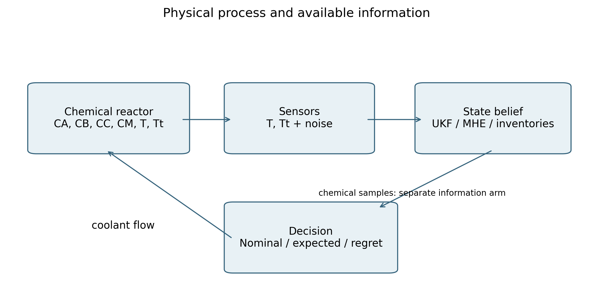

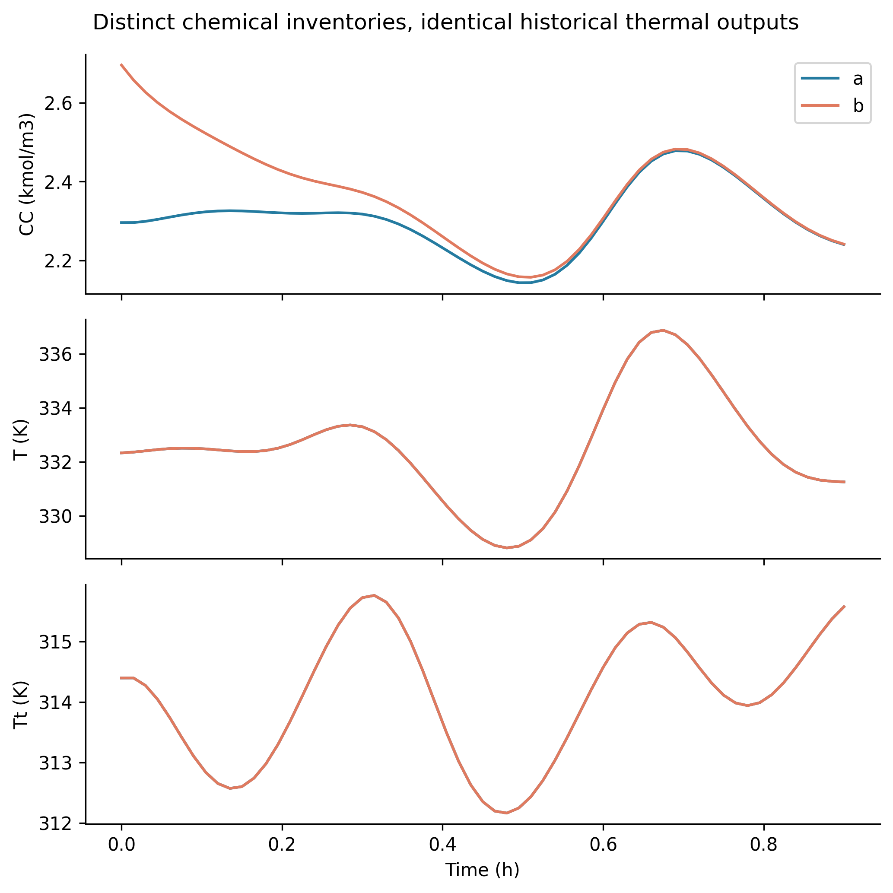

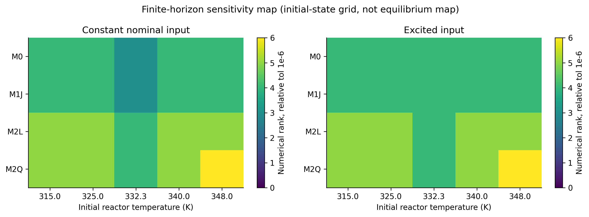

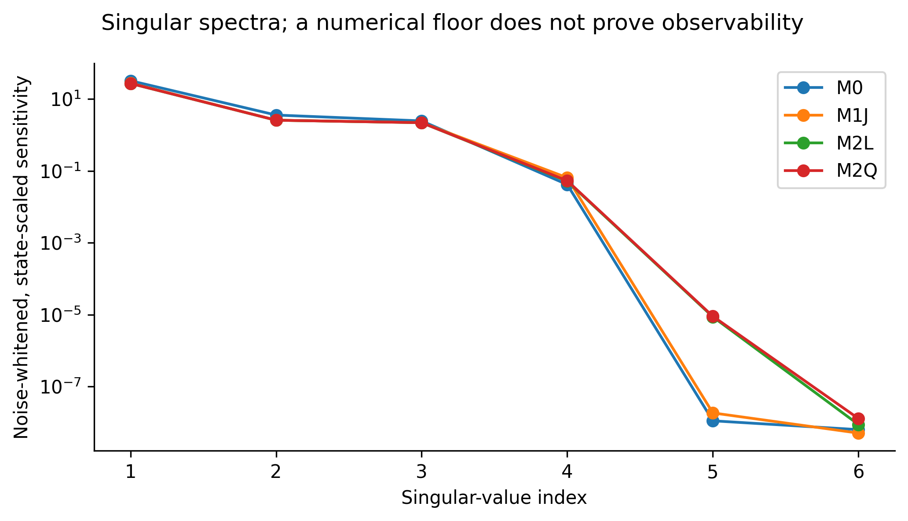

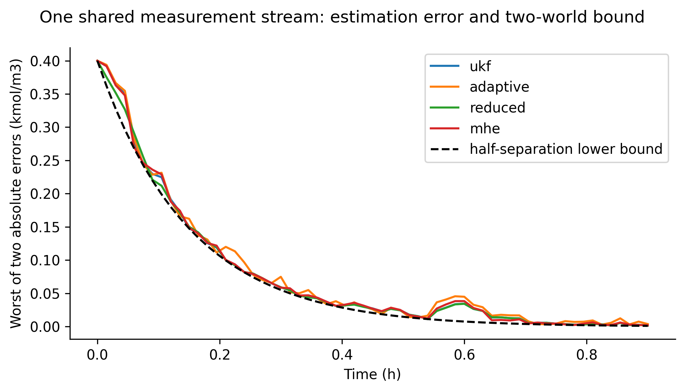

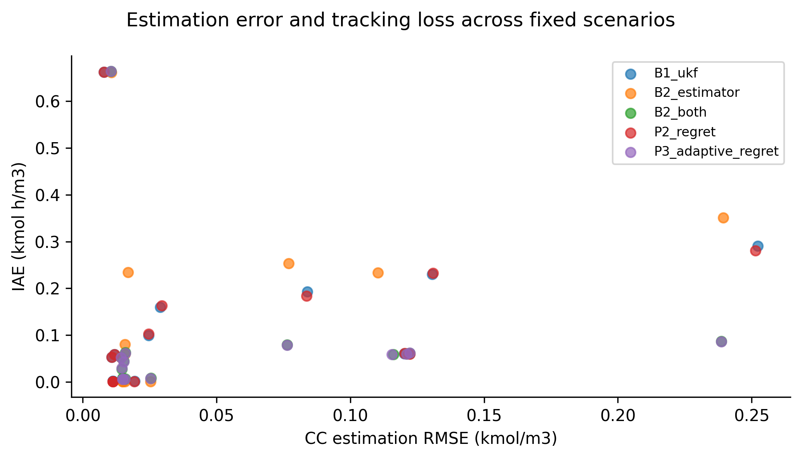

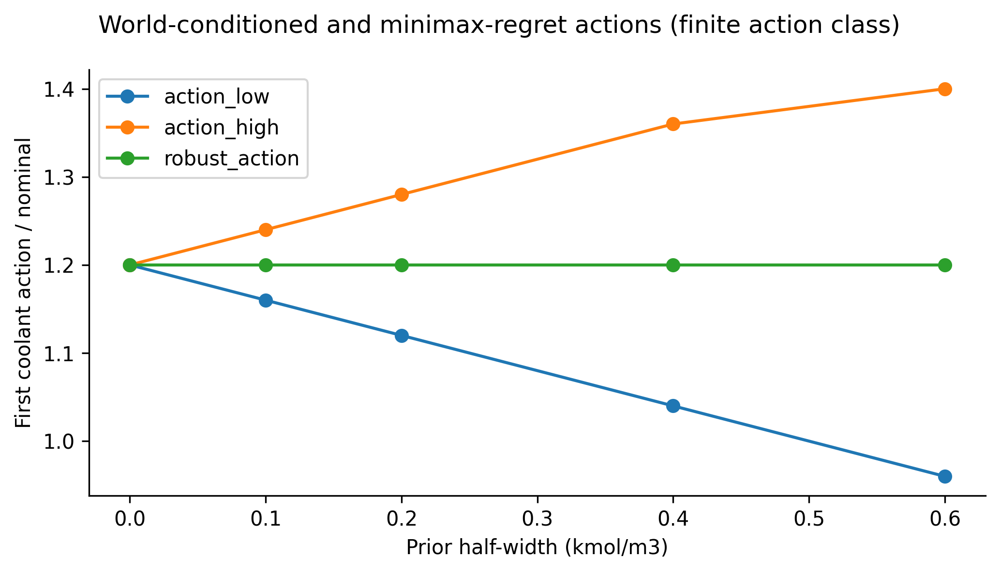

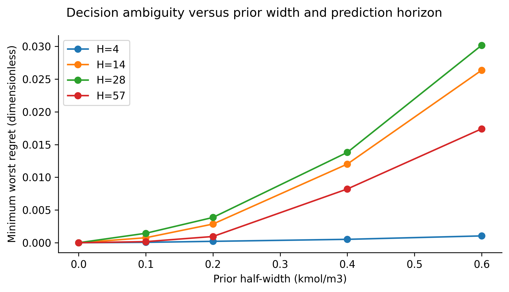

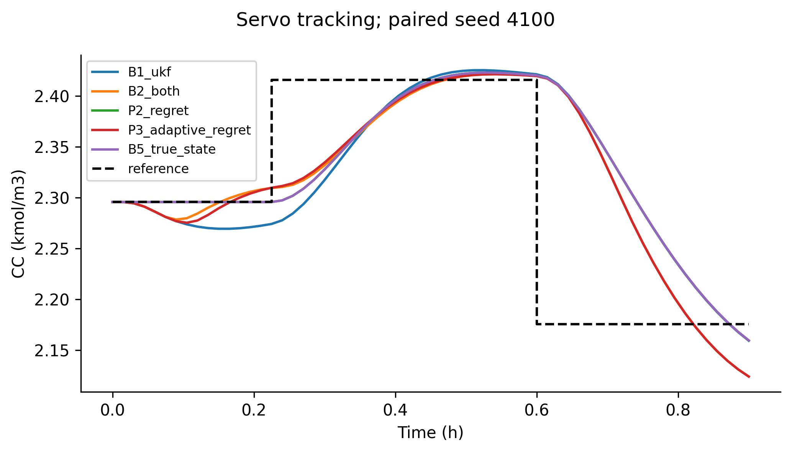

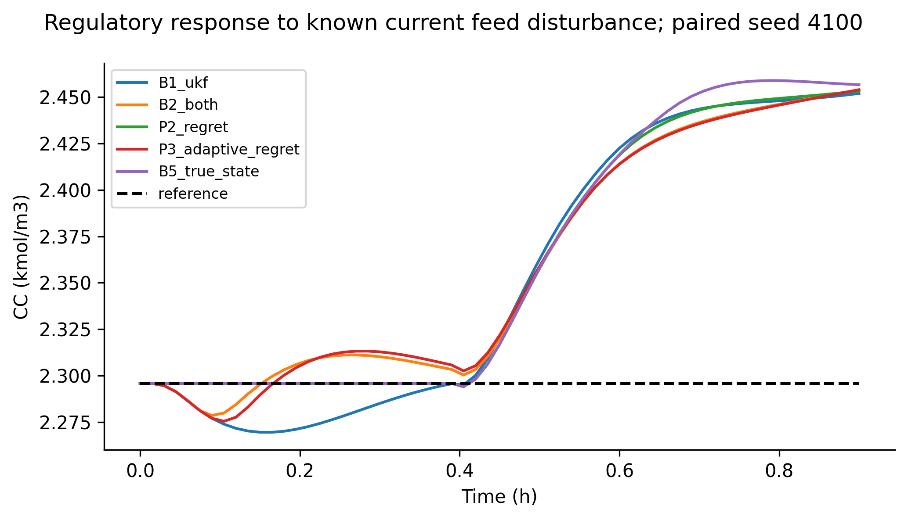

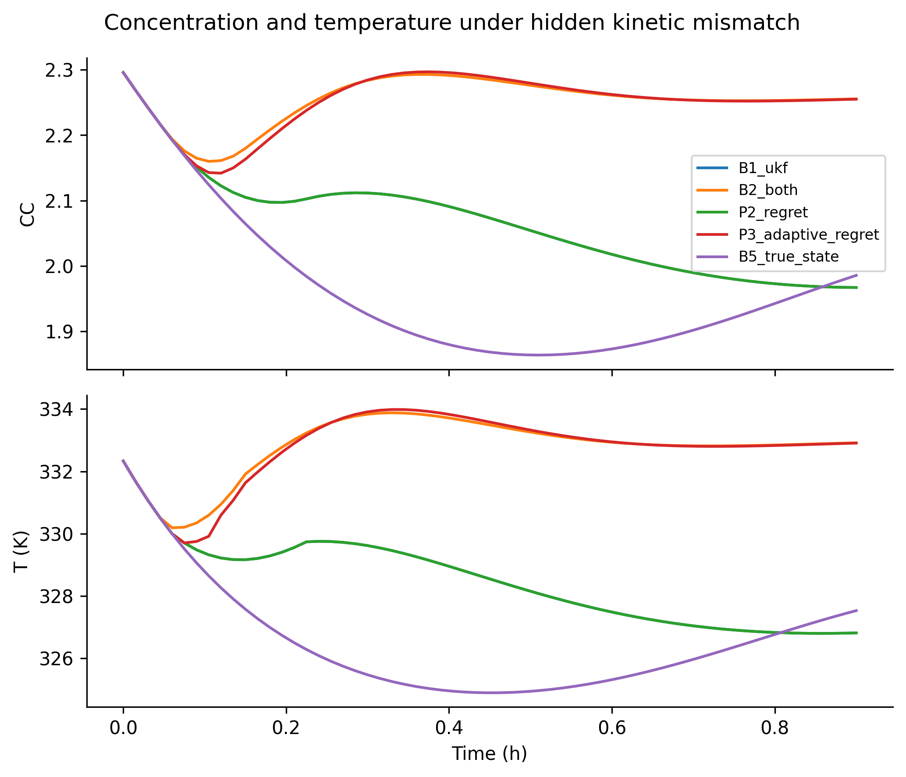

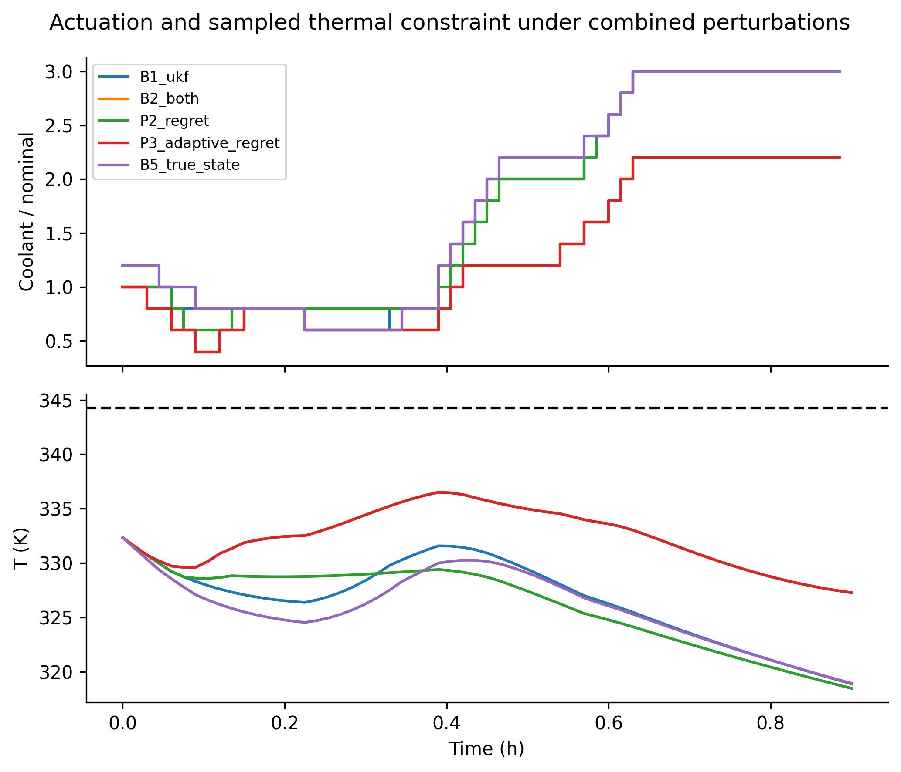

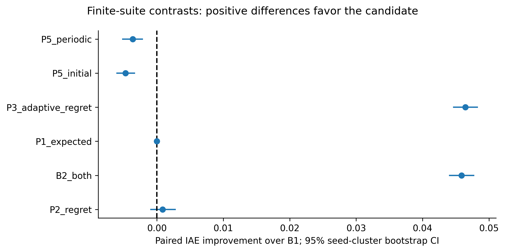

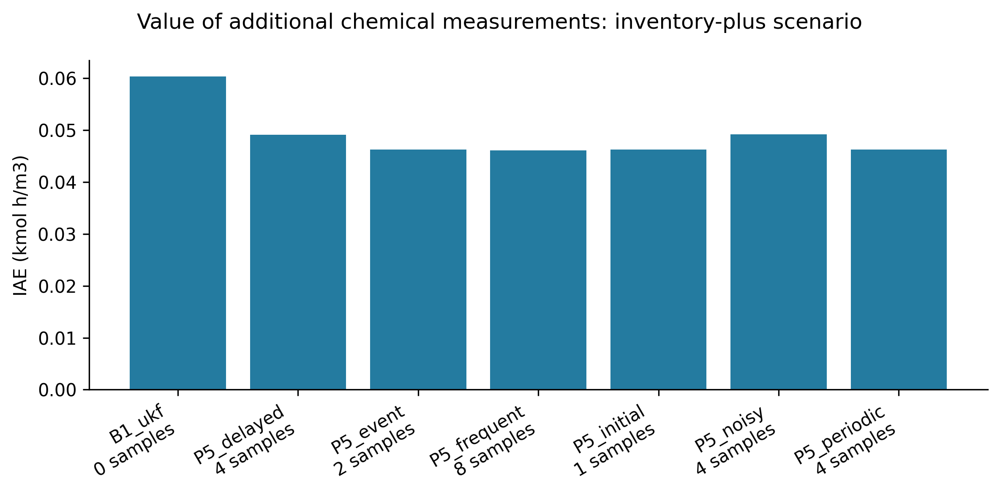

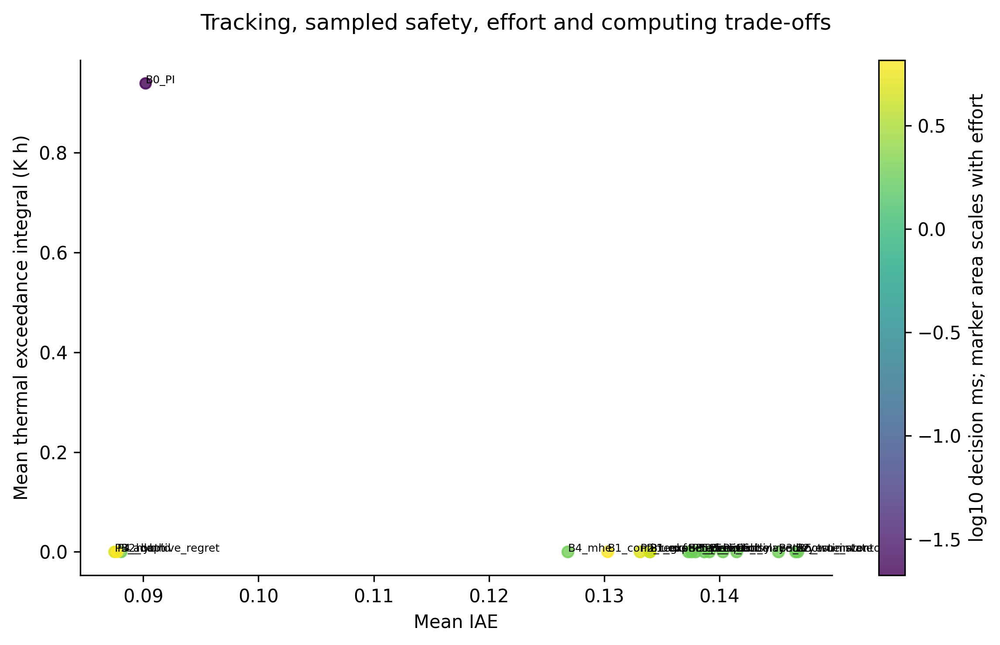

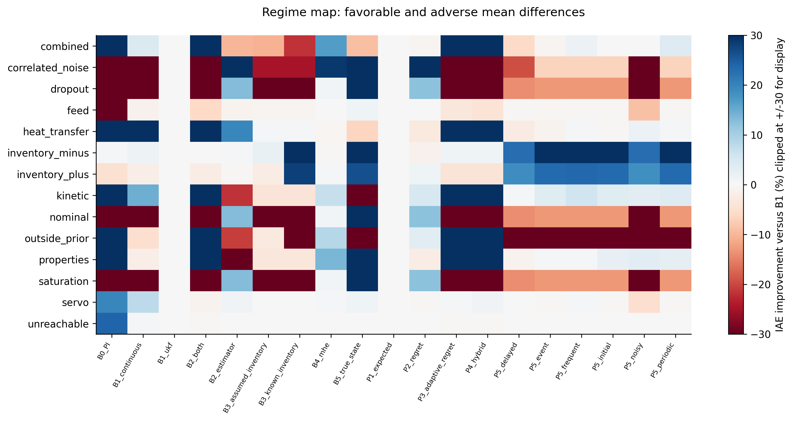
# References

